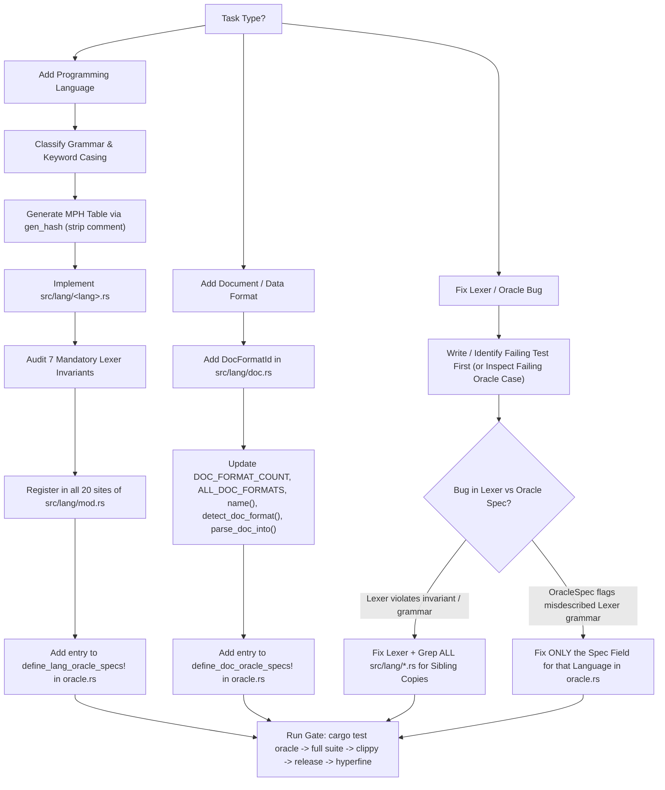

# `lfa` Language & Oracle Workflow (`flow.md`)

A deterministic execution guide and decision tree for adding languages, adding document formats, and diagnosing/fixing lexer bugs using [oracle.rs](file:///home/justin/Projects/lfa/src/lang/oracle.rs).

---

## 1. Non-Negotiable Rules & Pre-Flight

1. **Zero comments in Rust source (`src/`)**:
   - Never leave `//` or `/* */` comments anywhere under `src/`.
   - Remove the `// Solved in ...` header line printed by `cargo run --bin gen_hash` before pasting generated code.
2. **Zero `unsafe` blocks**:
   - `grep -rn "unsafe {" src` must remain empty.
3. **Never pollute the SIMD hot path (`TOKEN_KIND`)**:
   - Only add rare language triggers (`"`, `'`, `` ` ``, `/`, `#`, `;`, `--`, etc.) to `make_token_kind(...)`.
   - **Never** add common code bytes (`{`, `}`, `(`, `)`, `,`, or `;` when `;` is a statement terminator rather than a comment) to `TOKEN_KIND`.
   - If a rare construct needs gated tokens inside string interpolation, put it in `TOKEN_KIND_INTERP` + `TOKEN_INTERP_LUT_LO` with `SUPPORTS_TEMPLATES: bool = true`.
4. **Baseline binary before edits**:
   ```bash
   cargo build --release && cp target/release/lfa /tmp/lfa_base
   ```
   Build and save `/tmp/lfa_base` **before** touching code whenever modifying lexers or parsers so `hyperfine` can compare before vs. after in the same session.
5. **No heap allocations in `parse_into`** and no editing existing test assertions just to make a test pass.

---

## 2. Master Decision Tree



---

## 3. Adding a New Programming Language (Step-by-Step)

### Step 1: Classify the Language's Lexical Rules
Answer every item below **before** writing code; these exact answers feed both `src/lang/<lang>.rs` and `src/lang/oracle.rs`:

- **Case sensitivity**: Are keywords case-insensitive? (Existing caseless languages use `kw | 0x20` hashing and `match_keyword_caseless_with`; see `autohotkey.rs`, `sql.rs`, `fortran.rs`, `pascal.rs`).
- **Line comments**: Standard inline line comment prefix(es), e.g. `//`, `#`, `--`, `;`, `!`, `%`, `*>`, `;;`.
- **Line-start-only comments**: Column-0 / first-non-whitespace comments requiring `HAS_LINE_START_HOOK = true` (e.g., Fortran `c`/`C`/`*` in col 0, COBOL `*`/`/` in col 0 or col 7, Assembly `#` vs preprocessor lines).
- **Block comments**: Pair `(open, close, nested)` — e.g. `/* ... */` non-nested vs Rust/Swift/Kotlin/D `/* ... */` nested, Haskell `{- ... -}`, OCaml/Pascal/SML/F# `(* ... *)`, Lua `--[[ ... ]]`, HTML `<!-- ... -->`, Julia `#= ... =#`, Nim `#[ ... ]#`, MATLAB `%{ ... %}`, PowerShell `<# ... #>`, Scheme/Racket/CLisp `#| ... |#`, WAT `(; ... ;)`.
- **Line-delimited doc blocks**: Whole-line start/end markers like Perl `=pod`/`=cut` or Ruby `=begin`/`=end`.
- **Quoted literals**: Standard quotes with or without `\` escaping (`"`, `'`, `` ` ``).
- **Raw / Multi-line literals**: Delimiters like Rust `r#"..."#`, Python `"""..."""`/`'''...'''`, Go/JS `` `...` ``, Dart `r"..."` (stops at `\n`, `rqs`) vs `r"""..."""` (`rq`), Nix `''...''` (`rq`), Julia/Mojo `"""..."""`.
- **Identifier rules**:
  - `HAS_DOLLAR_IDENT`: `$` allowed inside identifiers (JS, PHP, Bash, etc.).
  - Special `handle_ident` / sigils: Should `$kw` suppress keyword matching (`suppress_sigils`), or should `@kw` match `kw` (`ident_prefixes`, e.g. Objective-C)? Should `kw:` suppress matching as a label/key (`suppress_suffixes`)?
- **Special constructs**:
  - Datum comments `#;` (Scheme/Racket) -> `skip_lisp_datum_with`.
  - EOF tail markers (`__END__`, `__DATA__`).
  - Line-spliced `//` (`handle_spliced_c_slash_comments`).
  - Template literals `${...}` (`SUPPORTS_TEMPLATES = true`, `TOKEN_KIND_INTERP`).
  - Char vs lifetime `'a` vs `'c'` (`handle_char_or_lifetime`).
  - C++ digit separators `1'000` (`cpp_sep`).
  - MATLAB postfix transpose `v'` (`transpose`).

### Step 2: Generate the Keyword Table (MPH)
Run `gen_hash` (pass `-i` ONLY for case-insensitive languages):
```bash
cargo run --bin gen_hash -- <kw1> <kw2> ...
```
Verify:
1. Delete the `// Solved in ...` comment line from the pasted output!
2. Keep `KEYWORD_NAMES` sorted and deduplicated.
3. Use the matching compile-time table builder from `src/lang/mod.rs` (`make_kw_table_fml_add`, `make_kw_table_fml_xor`, `make_kw_table_fl_add`, `make_kw_table_fsl_add`, `make_kw_table_b01ml_add`) with `match_keyword_with` (cased) or `match_keyword_caseless_with` (caseless).
4. Add compile-time `const _: () = assert!(...);` guards as in `src/bin/gen_hash.rs`.

### Step 3: Implement `src/lang/<lang>.rs` Using Existing Helpers
Reuse shared helpers in `src/lang/mod.rs` rather than rolling ad-hoc scanners:
- Line comments: `finish_line_comment`, `finish_spliced_line_comment`
- Slash comments: `handle_c_slash_comments`, `handle_nested_c_slash_comments`, `handle_spliced_c_slash_comments`
- Block / HTML / Nested comments: `handle_c_block_comment`, `handle_html_comment`, `finish_block_comment`, `handle_nested_2byte_comment`, `skip_nested_block_comment`, `skip_nested_2byte_comment`
- Quotes & literals: `handle_quoted_literal`, `handle_triple_or_quoted_literal`, `handle_char_or_lifetime`, `skip_literal`, `skip_triple_literal`
- Doc blocks: `skip_line_delimited_doc_block`, `count_doc_tail_lines`
- Templates: `skip_template`

Use a clean existing module matching your target grammar as a template (for example [autohotkey.rs](file:///home/justin/Projects/lfa/src/lang/autohotkey.rs) for simple `;` + `/* */` + caseless keywords, or sibling files in `src/lang/*.rs` for nested comments / quotes / line-start hooks).

### Step 4: Audit the 7 Mandatory Lexer Invariants (Avoid Past Bugs!)
Check every one of these before running tests:

1. **`STATE_CODE` on ALL non-comment `handle_special` fallback paths (most common bug!)**:
   - Every branch in `handle_special` that consumes non-comment characters — **including `_ => { *line_state |= STATE_CODE; i + 1 }` and delimiter mismatches like `/` not followed by `*` or `/`** — MUST set `*line_state |= STATE_CODE`.
   - Forgetting `*line_state |= STATE_CODE` in `_ => i + 1` causes lines containing only unrecognized special chars or trailing symbols at EOF to be miscounted as blank/zeroed.
2. **Audit every EOF / `content_len` exit**:
   - Test mentally: empty input `""`, no trailing `\n`, whitespace after code `"foo   "`, comment without `\n` `"// kw"`.
   - Ensure `lines == code + comments + blanks` and `parse(s) == parse(s + "\n")` when `s` does not end with `\n`.
   - Do not double-count newlines or drop the final line.
3. **Blank lines inside multi-line block comments / doc blocks**:
   - Empty or whitespace-only lines *inside* an open block comment or `=pod`/`=cut` block MUST count as `comment_lines`, not `blank_lines` (the shared `finish_block_comment` and `count_doc_tail_lines` helpers do this automatically).
4. **EOF markers (`__END__`, `__DATA__`)**:
   - Must only trigger at line start and only when immediately followed by `\n`, `\r`, or EOF (`i == content_len`) — never mid-word (like `__END__foo`).
   - Subsequent non-blank lines count as `comment_lines`; whitespace-only lines count as `blank_lines`.
5. **Single quotes vs lifetimes / atoms / transpose**:
   - If the language allows `'a` lifetimes, `'symbol` atoms, or `v'` transpose, NEVER blindly scan to the next `'` as a multi-line string (use `handle_char_or_lifetime` or check preceding/following bytes so unclosed `'` stops instead of eating the whole file).
6. **Sigils, prefixes, and suffixes**:
   - If `$kw` suppresses keyword matching, advance past the identifier in `handle_special` (`*line_state |= STATE_CODE; skip_ident(...)`).
   - If `@kw` still counts `kw`, set `*line_state |= STATE_CODE` and return `i + 1`.
   - Note: `unified_parse_into` only calls `L::handle_ident` when `L::HAS_SPECIAL_IDENT` is `true`!
7. **Line-start hooks (`HAS_LINE_START_HOOK = true`)**:
   - `handle_line_start` is invoked when `line_state == STATE_NONE` after leading `' '`, `'\t'`, and `'\r'` are skipped.
   - If the line does NOT match your special construct, return `i` unchanged without mutating `line_state` or `acc`.

### Step 5: Register in All 20 Sites of `src/lang/mod.rs`
Search for `AutoHotkey` / `autohotkey` across `src/lang/mod.rs` (`grep -n "AutoHotkey\|autohotkey" src/lang/mod.rs`) and add the exact matching entries at every site:

| # | Site in `src/lang/mod.rs` | Purpose |
| --- | --- | --- |
| 1 | `pub mod <lang>;` | Export module |
| 2 | `LangId` enum (`Variant = N,`) | Numeric ID (`< 128`) |
| 3 | `LANG_COUNT` + `LANG_<VARIANT>_MASK` | Increment count (max `128`), add `u128` bitmask |
| 4 | `ALL_LANGS` | Append `LangId::Variant` in exact `LangId` index order |
| 5 | `LangId::name` | Display string |
| 6 | `LangId::flag_aliases` | CLI filter flags (lowercase list) |
| 7 | `LangId::from_flag` | Case variants matching CLI flags |
| 8 | `LangStats` struct field | `pub <lang>: ParseResult<{ <lang>::KEYWORD_COUNT }>,` |
| 9 | `LangStats::add` | `self.<lang>.add(&other.<lang>);` |
| 10 | `LangStats::lines` | `LangId::Variant => self.<lang>.lines_processed,` |
| 11 | `LangStats::code_lines` | `LangId::Variant => self.<lang>.code_lines,` |
| 12 | `LangStats::comment_lines` | `LangId::Variant => self.<lang>.comment_lines,` |
| 13 | `LangStats::blank_lines` | `LangId::Variant => self.<lang>.blank_lines,` |
| 14 | `LangStats::total_keywords` | `LangId::Variant => self.<lang>.total_keywords,` |
| 15 | `LangStats::keyword_names` | `LangId::Variant => &<lang>::KEYWORD_NAMES,` |
| 16 | `LangStats::keyword_counts` | `LangId::Variant => &self.<lang>.keyword_counts,` |
| 17 | `LangStats::keyword_lens` | `LangId::Variant => &<lang>::KEYWORD_LENS,` |
| 18 | `LangStats::kw_min_max` | `LangId::Variant => (<lang>::KW_MIN_LEN, <lang>::KW_MAX_LEN),` |
| 19 | `LangStats::token_kind_and_lut` | `LangId::Variant => (&<lang>::TOKEN_KIND, &<lang>::TOKEN_LUT_LO),` |
| 20 | `detect_language` / `parse_into` / `mod tests` | Extension/filename routing (guarded by `enabled_mask & LANG_*_MASK`), `parse_into` dispatch, and comment-delimiter match arms in `mod tests` |

If `.ext` collides with an existing extension (like `.m` for `Matlab` vs `ObjectiveC`, or `.h` for `CHeader`), explicitly handle disambiguation in scheduler/CLI logic (`src/main.rs`) and `oracle.rs`. Also add `detect_shebang` support if scripts use a `#!` interpreter.

### Step 6: Register in `src/lang/oracle.rs`
Append your language at the **exact matching position** in `define_lang_oracle_specs!` in [oracle.rs](file:///home/justin/Projects/lfa/src/lang/oracle.rs):
- Set every field accurately (`file`, `caseless`, `line`, `line_start`, `block`, `doc_block`, `quotes`, `raw`, `prefixes`, `sigils`, `suffixes`, `datum`, `eof`, `spliced`, `tmpl`, `char_life`, `cpp_sep`, `transpose`, `tex_pct`, `perl_hash`, `ruby_def`).
- Use the helper constructors for `raw`:
  - `rq(open, close)`: multi-line raw string without `\` escapes
  - `rqs(open, close)`: single-line raw string stopping at `\n`
  - `rqe(open, close)`: multi-line quoted/triple string with `\` escapes
  - `rql(open)`: single-line to EOL

---

## 4. Adding a New Document / Data Format

1. In [doc.rs](file:///home/justin/Projects/lfa/src/lang/doc.rs):
   - Add variant to `DocFormatId` (`u8`, must stay `< 128` because `FileTarget::DOC_FLAG = 0x80`).
   - Increment `DOC_FORMAT_COUNT` and append to `ALL_DOC_FORMATS`.
   - Add display string in `DocFormatId::name`.
   - Add extension / exact-filename detection in `detect_doc_format`.
   - Implement line handling in `parse_doc_into`.
     - Remember: `doc.rs` strips one trailing `\r` per line; blank lines inside multi-line block comments count as `comment_lines`.
2. In [oracle.rs](file:///home/justin/Projects/lfa/src/lang/oracle.rs):
   - Add the format to `define_doc_oracle_specs!` in exact `ALL_DOC_FORMATS` order.

---

## 5. How to Run the Oracle & Diagnose Failures

Run the oracle suite alone first for fast feedback:
```bash
cargo test oracle
```

### Failure Diagnosis Decision Table

| Failing Test | What It Tested | Root Cause & Action |
| --- | --- | --- |
| `test_oracle_spec_completeness_and_file_detection` | Spec array length/order == `ALL_LANGS` / `ALL_DOC_FORMATS`, `detect_language` / `detect_doc_format`, basic `"  z9 = 42\n"` code line | Order/spelling mismatch between `mod.rs` and `oracle.rs`, or missing extension guard in `detect_language` / `detect_doc_format`. Fix registration or sample filename. |
| `test_oracle_all_keywords_exhaustive_ground_truth` | Every `KEYWORD_NAMES[slot]` across bare code, case variants, comments, quotes, sigils, prefixes | Broken MPH hash (`gen_hash` mismatch or wrong `caseless` flag), `KEYWORD_NAMES` out of sync with `KW_TABLE`, missing `STATE_CODE` on prefix, or missing sigil suppression in `handle_special`. Fix the lexer (`kw_hash` / `handle_ident` / `handle_special`) OR fix inaccurate `caseless`/`sigils`/`prefixes` in `oracle.rs`. |
| `test_oracle_synthesized_torture_programs_ground_truth` | Multi-feature torture program (LF, missing `\n`, byte-by-byte truncation `0..=len`, EOF line comment without `\n`, CRLF for docs) | EOF off-by-one (dropped/double-counted final line), raw/triple quote swallowing `\n` when language stops at `\n`, or missing `*line_state \|= STATE_CODE` in a `handle_special` arm. Inspect the language's EOF paths and `raw_quotes` spec. |
| `test_oracle_adversarial_boundaries_and_crlf` | Full CRLF code torture, ~8.5 KB block comment crossing AVX2 32-byte boundaries, two blocks on one line, `code /* c */ code`, depth-3 nested blocks, `+nl` invariant | CRLF `\r\n` bug in `handle_line_start` / spliced comments / `finish_trailing_line`, wrong `nested` flag in block comments, or SIMD remainder bug. Audit BOTH the lexer and sibling lexers (`grep` across `src/lang/*.rs`). |
| `test_oracle_adversarial_interactions` | Dense comma-separated keywords, quotes inside comments & comments inside quotes, `/*kw*/kw` adjacency, unclosed block comments at EOF | Quote/comment state leak, unclosed block comment dropping or misclassifying blank tail lines, or missing `*line_state \|= STATE_CODE` before comment open on mixed `kw/*unclosed` lines. |

**Critical rule when a failure hits**:
1. Never change a test assertion in `mod.rs` or `oracle.rs` merely to silence a failure.
2. Check which side encodes reality:
   - If the **lexer** miscounted lines/keywords or dropped EOF: fix the lexer AND grep `src/lang/*.rs` so every sibling parser with the same pattern gets the same fix.
   - If **only `LangOracleSpec` flags** disagreed with the language's real grammar (e.g. `rqs` vs `rq`, `nested: true` vs `false`): update that language's entry in `define_lang_oracle_specs!`, never weaken the generic `OracleBuilder` logic.

---

## 6. Mandatory Final Verification Gate (Before Commit / Reporting Done)

Run **all** of these checks after your final edit and verify every output:

```bash
cargo test
cargo clippy --all-targets
cargo build --release
./target/release/lfa . | grep Rust
grep -rn "unsafe {" src
```

Pass criteria:
- `cargo test`: `0 failed`, `0 ignored` (all unit + oracle tests passing).
- `cargo clippy --all-targets`: zero warnings.
- `./target/release/lfa . | grep Rust`: **Comments column MUST be `0`**.
- `grep -rn "unsafe {" src`: **empty output** (exit code `1`).

Then benchmark against your pre-edit baseline using exact flags:
```bash
hyperfine --style basic -N -w 5 -r 30 '/tmp/lfa_base /home/justin/Projects/lfa' './target/release/lfa /home/justin/Projects/lfa'
```
Report exact `mean ± σ` for both runs:
- If the difference is within `σ`, state that it is measurement noise (no regression, do not claim a speedup).
- **If any regression exceeds `σ`, STOP and discuss it with the user before proceeding.**
- Remember to clean up `/tmp/lfa_base` once benchmarking is finished and verified.
